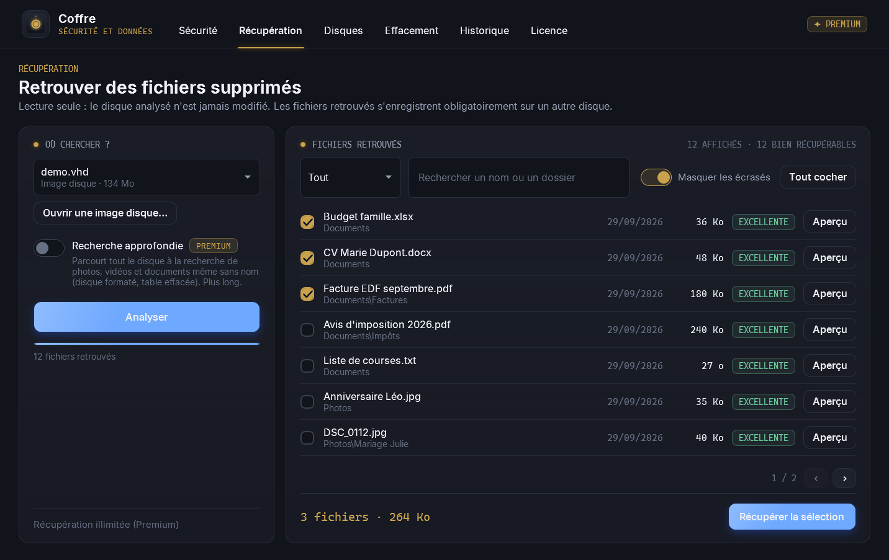
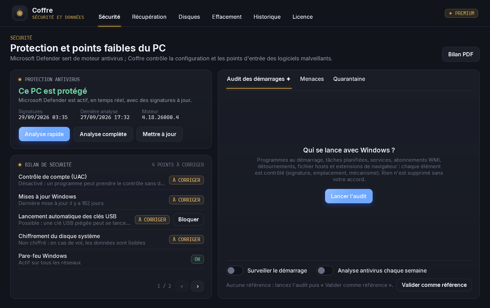
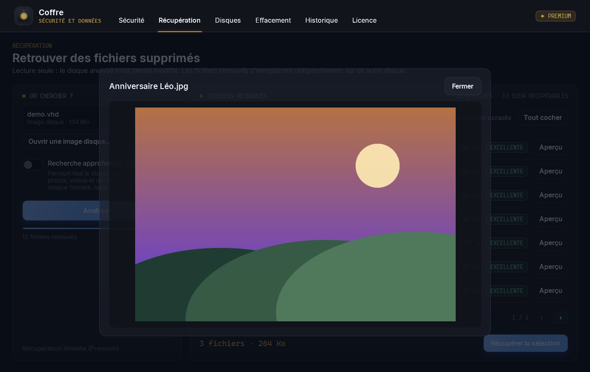
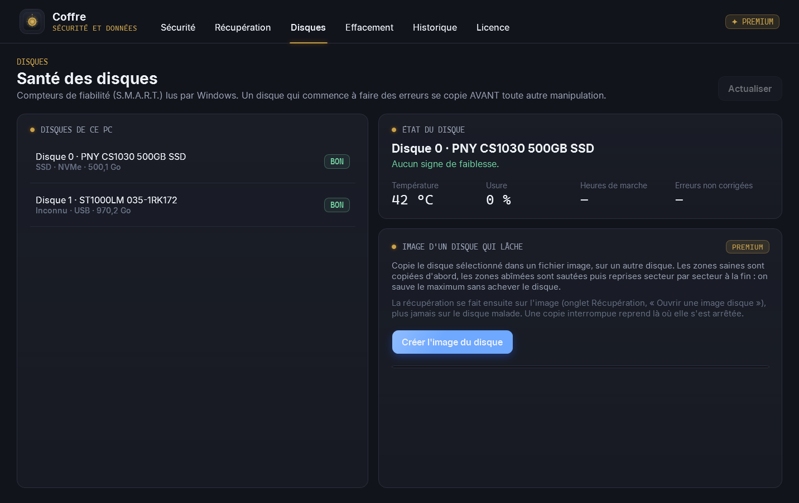
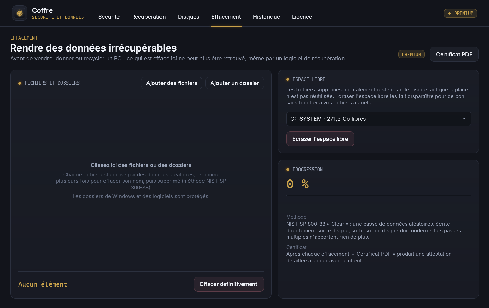

# 🔐 Coffre

### Protéger le PC, sauver les données, effacer pour de bon.

*Contrôle de la sécurité, récupération des fichiers supprimés, santé des disques et effacement sécurisé : les outils de l'atelier réunis dans un seul logiciel, en français, sans publicité.*

 

 

<i>Récupération : chaque fichier retrouvé reçoit une chance de récupération honnête, et se vérifie par un aperçu avant d'être sauvé.</i>

  

[**Pourquoi**](#-pourquoi-coffre-) · [**Fonctionnalités**](#-fonctionnalités) · [**Gratuit ou Premium**](#-gratuit-ou-premium-) · [**En images**](#%EF%B8%8F-en-images) · [**Télécharger**](#%EF%B8%8F-télécharger) · [**Questions fréquentes**](#-questions-fréquentes)

 

---

## 💡 Pourquoi Coffre ?

Une clé USB vidée par erreur, un disque qui commence à faire du bruit, un PC à revendre, un programme inconnu qui se lance au démarrage : ce sont les situations les plus courantes à l'atelier, et chacune demande d'habitude un logiciel différent, souvent en anglais, parfois douteux.

**Coffre a été conçu par un technicien, avec des règles strictes :**
- **Le disque analysé n'est jamais modifié.** Les fichiers retrouvés s'enregistrent obligatoirement sur un autre disque, pour ne pas écraser ce que l'on cherche à sauver.
- **Aucune promesse trompeuse.** Un fichier en partie écrasé est annoncé comme tel, jamais présenté comme intact.
- **Aucun antivirus « maison ».** La détection repose sur **Microsoft Defender**, mis à jour chaque jour ; Coffre le pilote et contrôle tout ce qu'un antivirus ne regarde pas.
- **Rien n'est supprimé sans votre accord**, et tout ce qui est mis en quarantaine se restaure en un clic.

 

## ✨ Fonctionnalités

<table>
<tr>
<td width="50%" valign="top">

### 🛡️ Sécurité
- État réel de la protection : antivirus actif, temps réel, signatures, dernière analyse.
- **Analyses rapide ou complète** et mise à jour de Microsoft Defender, menaces détectées et traitées.
- **Bilan de sécurité** : pare-feu, contrôle de compte, mises à jour, SMBv1, clés USB, bureau à distance, compte Invité, chiffrement ; correction en un clic quand c'est possible.
- **Bilan PDF** à remettre au client.

</td>
<td width="50%" valign="top">

### 🗂️ Récupération
- Fichiers supprimés sur **disques, clés USB et cartes mémoire** : NTFS, FAT32, exFAT.
- **Noms et dossiers d'origine** retrouvés, y compris les noms longs et accentués.
- **Chance de récupération** pour chaque fichier et **aperçu** des photos et textes.
- Lecture seule, zones illisibles comptées, récupération sur un autre disque.

</td>
</tr>
<tr>
<td width="50%" valign="top">

### 💽 Disques
- **Santé des disques** (S.M.A.R.T.) : température, usure des SSD, heures de marche, erreurs non corrigées.
- Verdict clair : bon, à surveiller, critique.
- **Image d'un disque qui lâche** : les zones saines d'abord, les zones abîmées en dernier, reprise après interruption.

</td>
<td width="50%" valign="top">

### 🧨 Effacement
- **Fichiers et dossiers rendus irrécupérables** (méthode NIST SP 800-88), noms compris.
- **Espace libre écrasé** : ce qui a été supprimé avant disparaît pour de bon.
- Avertissement honnête et TRIM sur SSD, dossiers de Windows protégés.
- **Certificat d'effacement PDF** à signer avec le client.

</td>
</tr>
</table>

 

## 💎 Gratuit ou Premium ?

Coffre est **gratuit pour toujours** pour protéger un PC et sauver quelques fichiers. La version **Premium** débloque les outils d'atelier, **à vie** sur votre ordinateur, pour **29 €** en une seule fois : pas d'abonnement.

| | Gratuit | ✦ Premium · 29 € à vie |
|---|:---:|:---:|
| Protection Microsoft Defender : état, analyses, mises à jour, menaces | ✅ | ✅ |
| Bilan de sécurité avec corrections, bilan PDF | ✅ | ✅ |
| Santé des disques (S.M.A.R.T.) | ✅ | ✅ |
| Analyse des fichiers supprimés (NTFS, FAT32) et aperçu | ✅ | ✅ |
| Récupération des fichiers | **jusqu'à 1 Go** | **illimitée** |
| **Recherche approfondie** : fichiers sans nom retrouvés par signature (disque formaté), clés et cartes **exFAT** | | ✅ |
| **Image d'un disque qui lâche**, avec reprise après coupure | | ✅ |
| **Audit avancé** du démarrage (tâches, services, WMI, hosts, extensions), **quarantaine réversible**, **surveillance** des nouveaux programmes et **analyse antivirus hebdomadaire** | | ✅ |
| **Effacement sécurisé** des fichiers et de l'espace libre, **certificat PDF** | | ✅ |

### Obtenir Premium · 29 €

1. Ouvrez l'onglet **Licence** de Coffre et cliquez sur **Copier** à côté de votre **code machine**.
2. Envoyez ce code à **S.O.S INFO LUDO** : ✉️ **s.o.sinfoludo@gmail.com** · 📞 **06 59 59 05 15** · 💬 **[Discord](https://discord.gg/W5hd36CW6b)**.
3. Réglez **29 €** : par **carte bancaire** (lien de paiement sécurisé Zettle envoyé par e-mail), par **virement**, ou en **espèces** à l'atelier de Boulogne-sur-Mer.
4. Vous recevez votre licence par e-mail : collez-la dans l'onglet **Licence** (ou ouvrez le fichier `.lic`), puis cliquez sur **Activer Premium**.

> La licence est vérifiée **sur votre PC, sans connexion Internet**, et reste valable à vie sur cet ordinateur. Micro-entreprise : TVA non applicable, article 293 B du CGI.

 

## 🖼️ En images

<table>
<tr>
<td width="50%" align="center">
 
<b>Sécurité</b> Protection antivirus, bilan des points faibles et audit des programmes qui se lancent avec Windows.
</td>
<td width="50%" align="center">
 
<b>Aperçu avant récupération</b> On vérifie la photo avant de la sauver : pas de mauvaise surprise.
</td>
</tr>
<tr>
<td width="50%" align="center">
 
<b>Disques</b> Température, usure et erreurs lues dans le disque ; image d'un disque malade.
</td>
<td width="50%" align="center">
 
<b>Effacement</b> Fichiers, dossiers ou espace libre rendus irrécupérables, avec certificat.
</td>
</tr>
</table>

 

## ⬇️ Télécharger

### [**➜ Page de téléchargement (dernière version)**](https://github.com/lerapeurdu62280-debug/Coffre-Download/releases/latest)

| Fichier | Pour qui ? |
|---|---|
| **`Coffre-Setup.exe`** | Installation classique, avec raccourci dans le menu Démarrer. **Recommandé.** |
| **`Coffre-Portable.exe`** | Aucune installation : un seul fichier, à lancer depuis une clé USB. Idéal en dépannage : **on n'installe rien sur un disque dont on veut récupérer les fichiers.** |

> **Windows affiche « Windows a protégé votre ordinateur » ?** C'est normal pour un logiciel récent. Cliquez sur **Informations complémentaires**, puis sur **Exécuter quand même**.
>
> Coffre demande les **droits administrateur** au lancement : ils sont nécessaires pour lire un disque secteur par secteur et piloter Microsoft Defender.

### 🖥️ Configuration requise
- **Windows 10 ou 11**, 64 bits. Rien d'autre à installer.
- Environ **250 Mo** d'espace disque, et un **second disque** (clé USB, disque externe) pour enregistrer les fichiers récupérés.

 

## ❓ Questions fréquentes

<b>Coffre peut-il récupérer tous mes fichiers ?</b>

 
Personne ne peut le promettre honnêtement. Un fichier supprimé reste récupérable tant que sa place sur le disque n'a pas été réutilisée : c'est pourquoi il faut arrêter d'utiliser le disque au plus vite et ne rien y installer. Coffre indique pour chaque fichier sa chance de récupération (excellente, bonne, partielle, écrasé) et permet de le vérifier par un aperçu avant de le récupérer.

<b>Coffre remplace-t-il mon antivirus ?</b>

 
Coffre utilise Microsoft Defender, l'antivirus intégré à Windows, comme moteur de détection : c'est un antivirus complet, mis à jour chaque jour. Si vous avez un autre antivirus, Coffre le détecte et le respecte. Coffre ajoute ce que l'antivirus ne vérifie pas : la configuration de Windows et les programmes qui se lancent au démarrage.

<b>Un élément « suspect » est-il forcément un virus ?</b>

 
Non. « Suspect » signifie que l'élément cumule des indices typiques des logiciels malveillants (programme non signé lancé depuis un dossier modifiable, mécanisme rarement utilisé par les logiciels normaux). Coffre explique pourquoi et ne supprime rien de lui-même. Si vous le neutralisez, il part en quarantaine et peut être restauré à l'identique.

<b>L'effacement sécurisé fonctionne-t-il sur un SSD ?</b>

 
Sur un disque dur, oui, de façon certaine. Sur un SSD, le contrôleur du disque peut conserver des copies internes que Windows ne voit pas : Coffre écrase les données, demande au SSD d'effacer les blocs libérés (TRIM) et vous le signale clairement. Pour une garantie totale sur SSD, le chiffrement complet du disque (BitLocker) ou l'effacement du fabricant restent la référence.

<b>Coffre envoie-t-il des données sur Internet ?</b>

 
Non. Tout se passe sur votre PC : aucun fichier, aucune analyse et aucune information personnelle ne sont envoyés. La licence elle-même est vérifiée hors ligne.

<b>Je change d'ordinateur : ma licence Premium est-elle perdue ?</b>

 
La licence est liée à un ordinateur. En cas de changement de PC ou de carte mère, contactez S.O.S INFO LUDO avec votre nouveau code machine.

 

---

💬 Une question, un souci ? Rejoignez le **[Discord de l'atelier](https://discord.gg/W5hd36CW6b)**.

**Coffre** · conçu et développé par **S.O.S INFO LUDO**, Boulogne-sur-Mer

Logiciel propriétaire, tous droits réservés. Composants tiers : QuestPDF (licence Community), CommunityToolkit.Mvvm (MIT), polices Inter et Cascadia Mono (OFL). Windows et Microsoft Defender sont des marques de Microsoft Corporation. Ce logiciel est indépendant.

